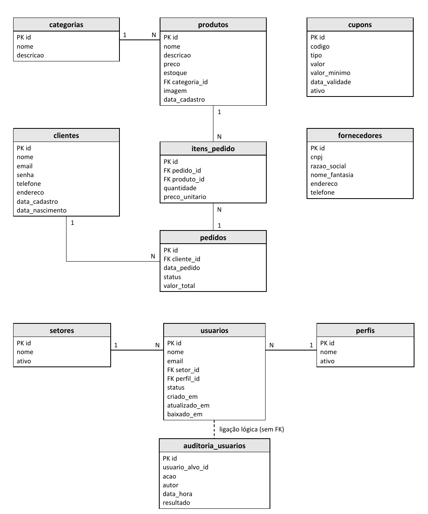

# Banco de dados

O banco se chama `loja_enxoval`. O arquivo `database/database.sql` cria as tabelas da loja e o
`database/sprint01_usuarios.sql` cria o módulo de usuários. As páginas atuais usam apenas as tabelas desse módulo.

## DER

PK é a chave primária e FK é a chave estrangeira. A ligação de `auditoria_usuarios` com `usuarios` é apenas lógica (sem FK).

## Dicionário de dados

### categorias

| Coluna | Tipo | Obrig. | Chave | Descrição |
|---|---|---|---|---|
| id | INT, automático | Sim | PK | Número da categoria |
| nome | VARCHAR(100) | Sim | Única | Cama, Mesa ou Banho |
| descricao | TEXT | Não | — | Itens da categoria |

### produtos

| Coluna | Tipo | Obrig. | Chave | Descrição |
|---|---|---|---|---|
| id | INT, automático | Sim | PK | Número do produto |
| nome | VARCHAR(150) | Sim | — | Nome |
| descricao | TEXT | Não | — | Detalhes |
| preco | DECIMAL(10,2) | Sim | — | Preço em reais |
| estoque | INT | Sim | — | Quantidade; padrão 0 |
| categoria_id | INT | Sim | FK | Categoria |
| imagem | VARCHAR(255) | Não | — | Arquivo da foto |
| data_cadastro | TIMESTAMP | Não | — | Data atual |

### clientes

| Coluna | Tipo | Obrig. | Chave | Descrição |
|---|---|---|---|---|
| id | INT, automático | Sim | PK | Número do cliente |
| nome | VARCHAR(150) | Sim | — | Nome |
| email | VARCHAR(150) | Sim | Única | E-mail |
| senha | VARCHAR(50) | Sim | — | Senha, ainda sem criptografia |
| telefone | VARCHAR(20) | Não | — | Telefone |
| endereco | TEXT | Não | — | Endereço |
| data_cadastro | TIMESTAMP | Não | — | Data atual |
| data_nascimento | DATE | Não | — | Nascimento |

### pedidos

| Coluna | Tipo | Obrig. | Chave | Descrição |
|---|---|---|---|---|
| id | INT, automático | Sim | PK | Número do pedido |
| cliente_id | INT | Sim | FK | Quem comprou |
| data_pedido | TIMESTAMP | Não | — | Data |
| status | VARCHAR(50) | Sim | — | Padrão Pendente |
| valor_total | DECIMAL(10,2) | Sim | — | Total |

### itens_pedido

| Coluna | Tipo | Obrig. | Chave | Descrição |
|---|---|---|---|---|
| id | INT, automático | Sim | PK | Número do item |
| pedido_id | INT | Sim | FK | Pedido (apagado junto) |
| produto_id | INT | Sim | FK | Produto |
| quantidade | INT | Sim | — | Quantidade |
| preco_unitario | DECIMAL(10,2) | Sim | — | Preço na compra |

### cupons

| Coluna | Tipo | Obrig. | Chave | Descrição |
|---|---|---|---|---|
| id | INT, automático | Sim | PK | Número do cupom |
| codigo | VARCHAR(50) | Sim | Única | Código |
| tipo | VARCHAR(20) | Sim | — | percentual ou fixo |
| valor | DECIMAL(10,2) | Sim | — | Desconto |
| valor_minimo | DECIMAL(10,2) | Não | — | Compra mínima |
| data_validade | DATE | Sim | — | Validade |
| ativo | BOOLEAN | Sim | — | Pode ser usado |

### fornecedores

| Coluna | Tipo | Obrig. | Chave | Descrição |
|---|---|---|---|---|
| id | INT, automático | Sim | PK | Número do fornecedor |
| cnpj | VARCHAR(14) | Sim | Única | Só números |
| razao_social | VARCHAR(180) | Sim | Única | Nome oficial |
| nome_fantasia | VARCHAR(180) | Não | — | Nome comercial |
| endereco | TEXT | Não | — | Endereço |
| telefone | VARCHAR(20) | Não | — | Telefone |

### setores

| Coluna | Tipo | Obrig. | Chave | Descrição |
|---|---|---|---|---|
| id | INT, automático | Sim | PK | Número do setor |
| nome | VARCHAR(100) | Sim | Única | Nome do setor |
| ativo | TINYINT(1) | Sim | — | 1 = disponível |

### perfis

| Coluna | Tipo | Obrig. | Chave | Descrição |
|---|---|---|---|---|
| id | INT, automático | Sim | PK | Número do perfil |
| nome | VARCHAR(100) | Sim | Única | Nome do perfil |
| ativo | TINYINT(1) | Sim | — | 1 = disponível |

### usuarios

| Coluna | Tipo | Obrig. | Chave | Descrição |
|---|---|---|---|---|
| id | INT, automático | Sim | PK | Número do usuário |
| nome | VARCHAR(150) | Sim | — | Nome completo |
| email | VARCHAR(150) | Sim | Única | E-mail |
| setor_id | INT | Sim | FK | Setor |
| perfil_id | INT | Sim | FK | Perfil |
| status | ENUM | Sim | Índice | Ativo (padrão) ou Baixa |
| criado_em | TIMESTAMP | Sim | — | Data do cadastro |
| atualizado_em | TIMESTAMP | Sim | — | Última mudança |
| baixado_em | TIMESTAMP | Não | — | Data da baixa |

### auditoria_usuarios

| Coluna | Tipo | Obrig. | Chave | Descrição |
|---|---|---|---|---|
| id | INT, automático | Sim | PK | Número do registro |
| usuario_alvo_id | INT | Não | Índice | Usuário afetado (sem FK) |
| acao | VARCHAR(30) | Sim | — | cadastro ou baixa |
| autor | VARCHAR(100) | Sim | — | Hoje “sistema” |
| data_hora | TIMESTAMP | Sim | — | Quando |
| resultado | VARCHAR(200) | Sim | — | Sucesso ou motivo da falha |

## Padrão de nomes usado

- Tabelas no plural e em minúsculas.
- Colunas em snake_case: criado_em, preco_unitario.
- FK com o nome no singular + _id: setor_id, produto_id.
- Sem acento e sem espaço.
