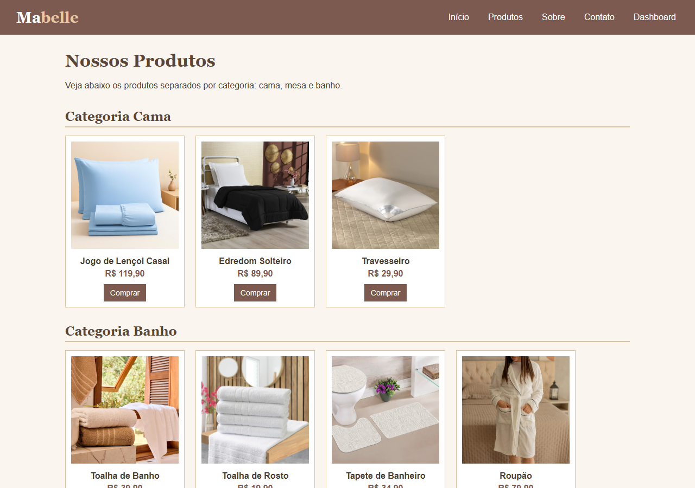
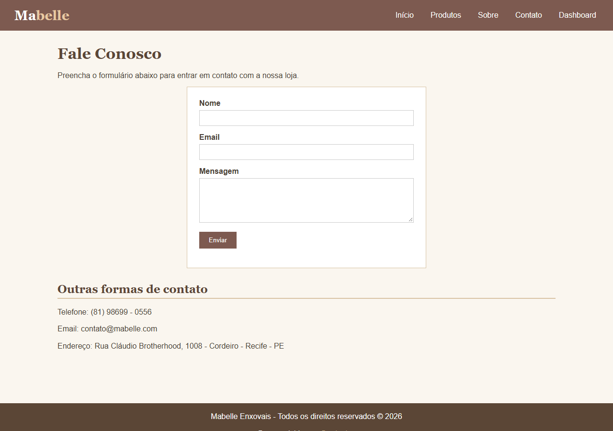
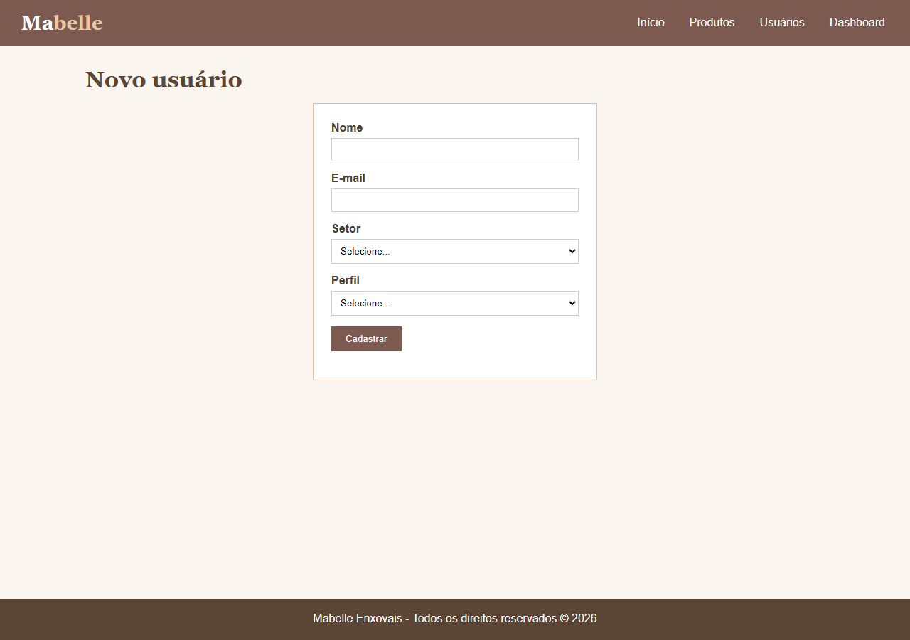
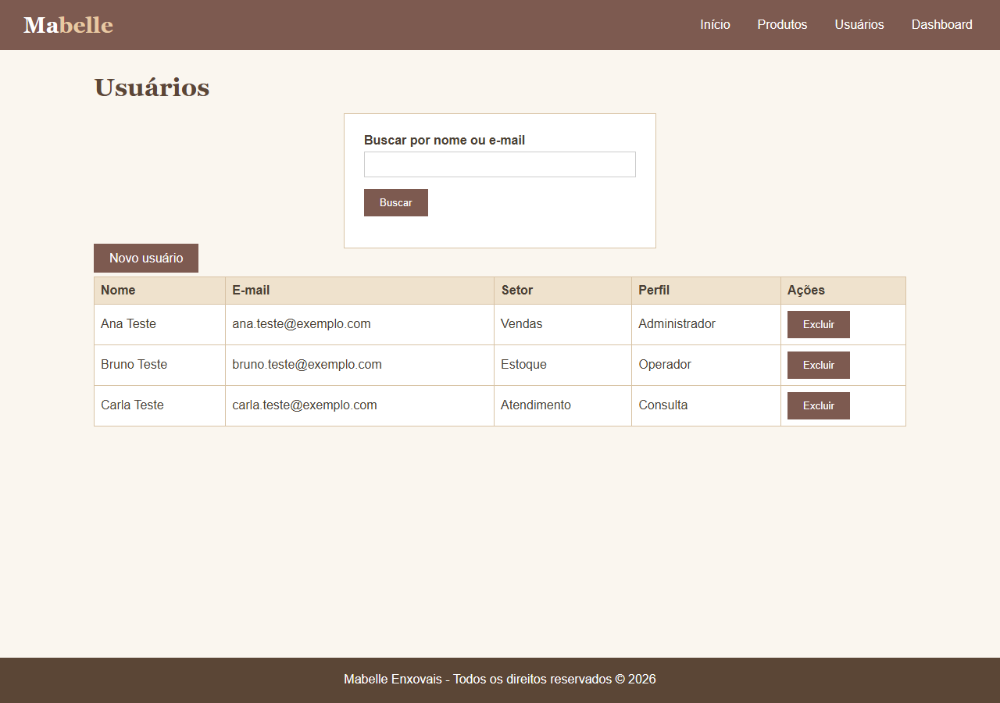
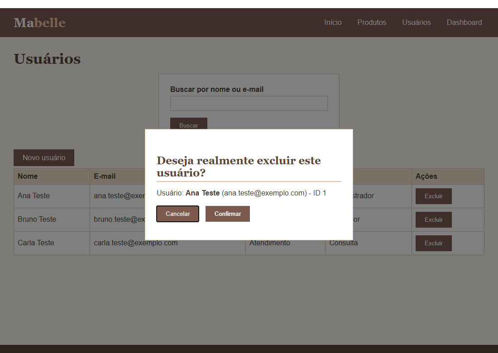

# Manual do usuário

## Como ver os produtos
1. No menu, clique em **Produtos**.
2. Escolha **Cama**, **Mesa** ou **Banho**.
3. O botão **Comprar** mostra um aviso; a compra ainda não é registrada.

## Como falar com a loja
1. Clique em **Contato**.
2. Use o telefone ou o e-mail da página. O formulário ainda não envia mensagens.

## Como cadastrar um usuário
1. Clique em **Dashboard** e em **Usuários**.
2. Clique em **Novo usuário**.
3. Preencha **Nome**, **E-mail**, **Setor** e **Perfil**.
4. Clique em **Cadastrar**.

## Como procurar um usuário
1. Digite o nome ou o e-mail na busca.
2. Clique em **Buscar**.

## Como excluir um usuário
1. Clique em **Excluir** na linha da pessoa.
2. Confira os dados.
3. Clique em **Confirmar**, ou em **Cancelar** para desistir.

## Perguntas frequentes
**O usuário excluído foi apagado?** Não. Ele fica no banco com o status Baixa.

**Por que o e-mail foi recusado?** Ele é inválido ou já está cadastrado.
